# GFL diagrams as code

Each diagram is a Mermaid text source (`*.mmd`), versioned with the code it describes. GitHub renders the copies below directly. Each source states where its facts come from, and every one is checked to render with `mmdc`.

Not drawn yet, and planned for the WP5 documentation: CI and AAL Verify workflow; the role of each AI and tool (DEC-037 table); dashboard screen map.

## D01 — System architecture: one canonical core, two interfaces
Source: [`D01_system_architecture.mmd`](D01_system_architecture.mmd)

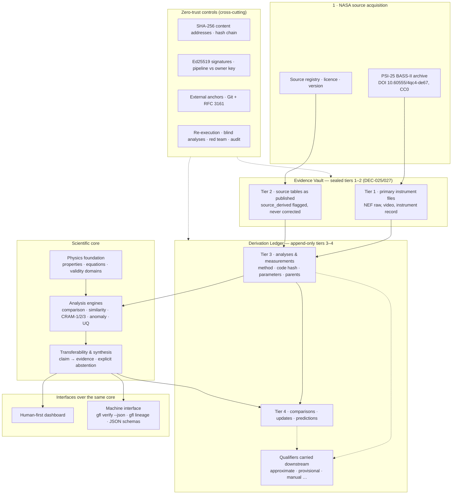

## D02 — Evidence data path
Source: [`D02_evidence_data_path.mmd`](D02_evidence_data_path.mmd)

```mermaid
%% D02 — Evidence data path, source to audit result (PROJECT_MASTER_MAP §4.1).
flowchart LR
  a[Source registry] --> b[Acquisition<br/>immutable raw inventory] --> c[Format-specific extraction<br/>PDF · CSV · XLSX · NEF · video]
  c --> d[Source assertions<br/>exact locators] --> e[Identity resolution<br/>experiment · run · sample · config]
  e --> f[Typed quantities<br/>original units · lineage] --> g[(Canonical evidence graph)]
  g --> h[Provenance & integrity validation] --> i[Outcome-specific comparability] --> j[Transfer assessment<br/>uncertainty · limits]
  j --> k[Machine-readable audit result<br/>+ human explanation]
  h -. failure .-> x[Flag — never silent deletion]
```

## D03 — Ledger entry model
Source: [`D03_ledger_model.mmd`](D03_ledger_model.mmd)

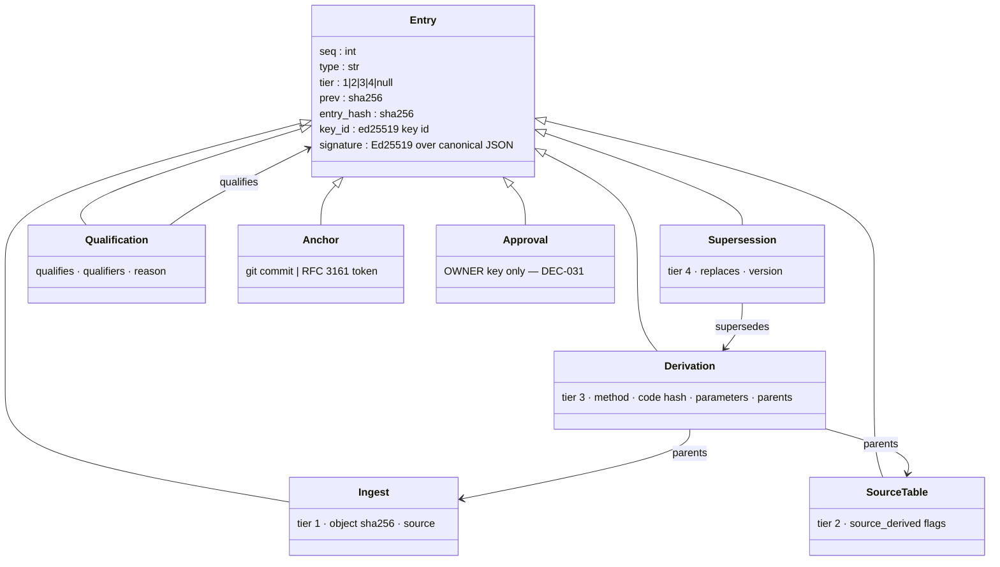

## D04 — `gfl verify`: checks and outcomes
Source: [`D04_verify_flow.mmd`](D04_verify_flow.mmd)

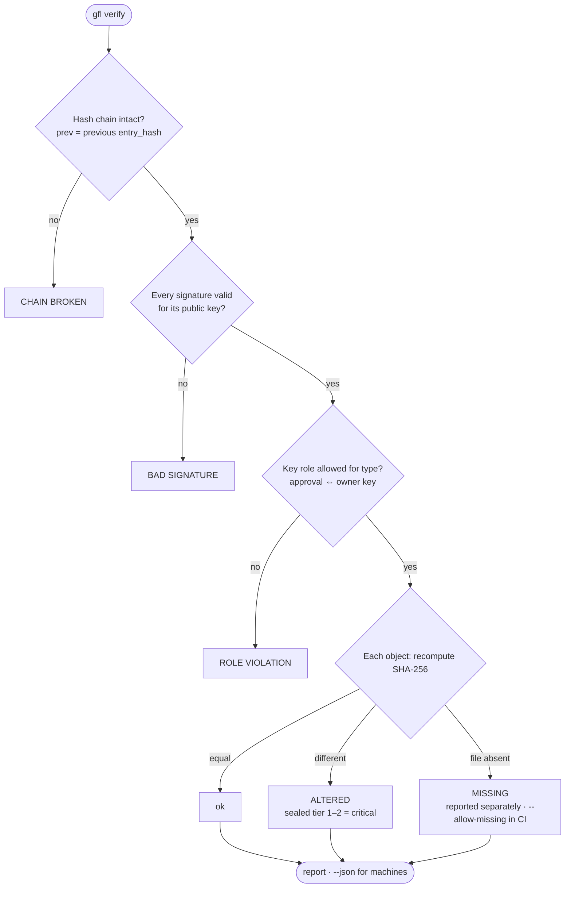

## D05 — Separation of signing authority and external anchors
Source: [`D05_signing_authority.mmd`](D05_signing_authority.mmd)

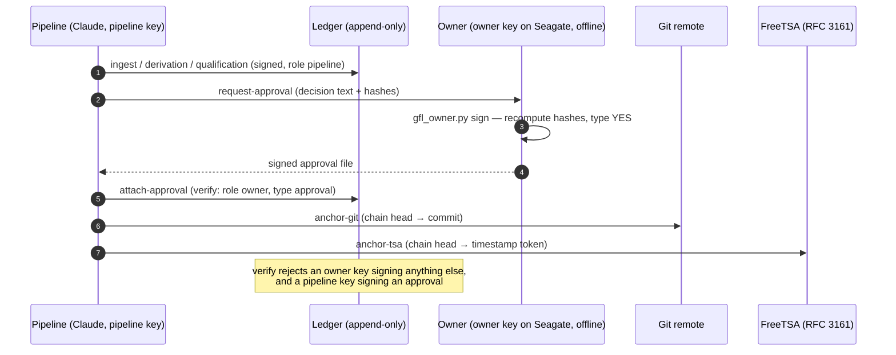

## D06 — Evidence Vault phases
Source: [`D06_vault_phases.mmd`](D06_vault_phases.mmd)

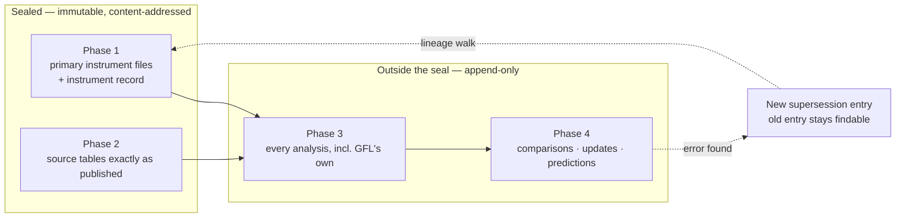

## D07 — B6 flame-spread measurement pipeline
Source: [`D07_b6_measurement.mmd`](D07_b6_measurement.mmd)

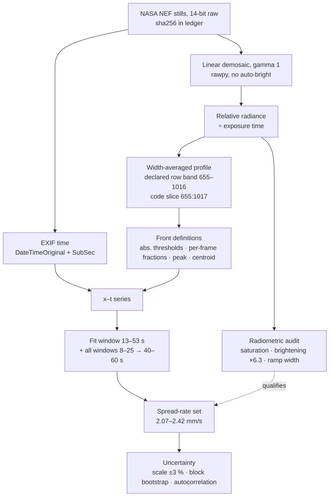

## D08 — Zero-trust verification loop
Source: [`D08_zero_trust_loop.mmd`](D08_zero_trust_loop.mmd)

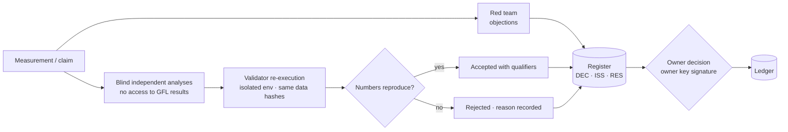

## D09 — AAL pipeline `gfl_review` (WF-0011)
Source: [`D09_aal_gfl_review.mmd`](D09_aal_gfl_review.mmd)

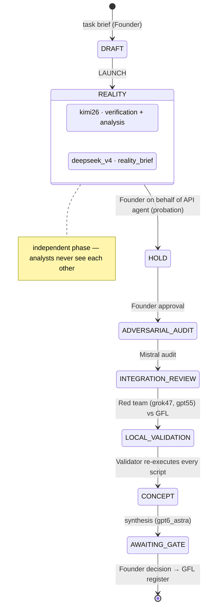

## D10 — Delivery plan to the freeze
Source: [`D10_roadmap.mmd`](D10_roadmap.mmd)

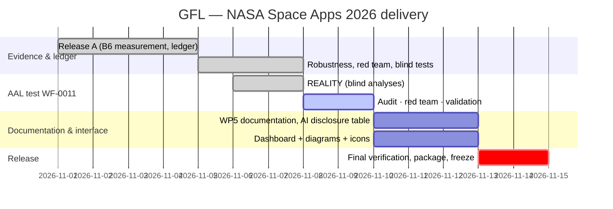

## D11 — Canonical evidence graph node classes
Source: [`D11_evidence_graph.mmd`](D11_evidence_graph.mmd)

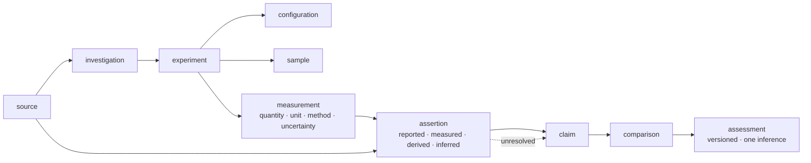
